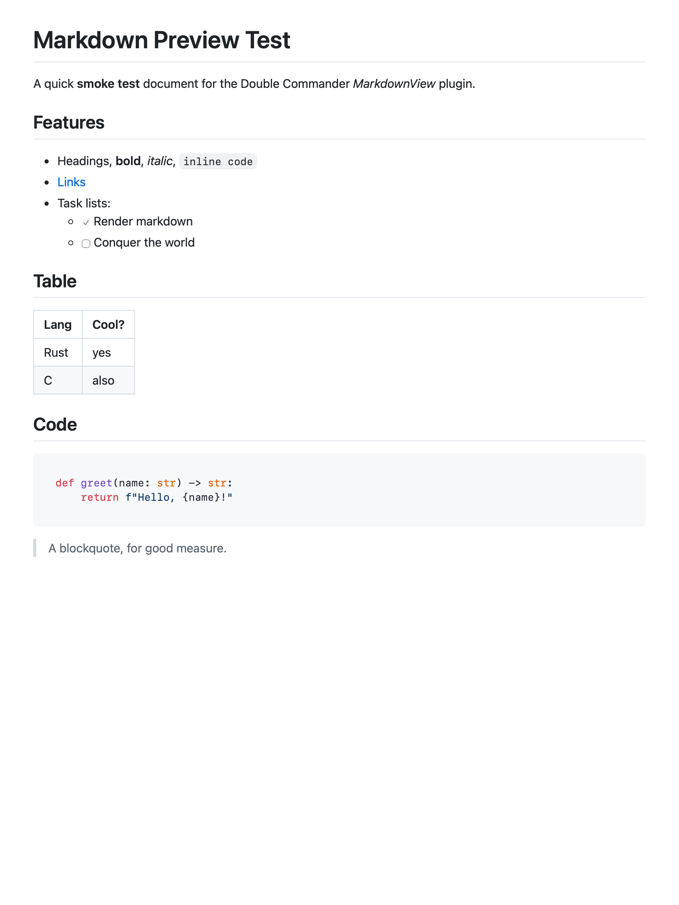
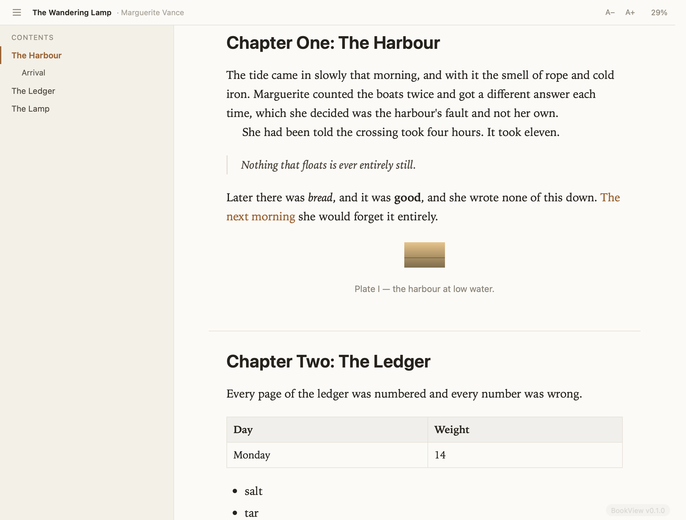
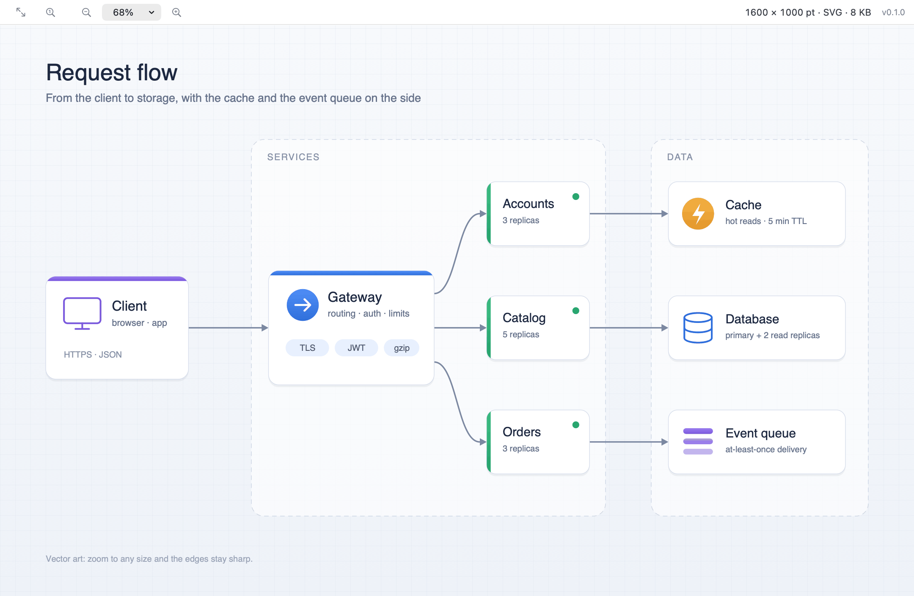

# Double Commander Plugins for macOS

Native plugins for [Double Commander](https://doublecmd.sourceforge.io/) on macOS,
built to a consistent engineering standard: **universal binaries** (Apple Silicon +
Intel), **headless tests**, **CI**, and a layered **safety gate** before anything ships.

Five plugins cover Markdown, e-books, images and PDFs, spreadsheet previews, and
media metadata. The viewers open inside Double Commander's F3 viewer and Quick
View. All use the Total Commander WLX/WDX plugin ABI and work offline.

This repo is also a worked example of how I build small native tools end-to-end —
investigate the platform, prove the mechanism with a focused test before writing the
feature, fix root causes instead of papering over them, and keep the result
reproducible and documented.

## Plugins

| Plugin | Type | What it does | Status |
|--------|------|--------------|--------|
| [`markdown-wlx`](markdown-wlx/) | WLX (lister) | Renders Markdown beautifully in DC's viewer (F3) — GitHub-style CSS, syntax highlighting, tables, task lists, **Mermaid diagrams**, **KaTeX math**, configurable light/dark. Search, copy, and print or save as PDF with **Page N of M** footers. Toggle back to raw text anytime. | ✅ stable |
| [`media-info-wdx`](media-info-wdx/) | WDX (content) | Shows media metadata in custom **columns** & tooltips — image/video **resolution**, audio/video **duration**, bitrate, codecs, PDF **page count**, plus an adaptive `Summary` field. Native ImageIO / AVFoundation / CGPDF; no deps, no network. | ✅ stable |
| [`book-wlx`](book-wlx/) | WLX (lister) | Reads **EPUB and FictionBook (FB2) e-books** in the viewer (F3) — contents sidebar, continuous reflowable text, cover, reading progress, adjustable text size, light/dark/sepia. Served straight out of the container in-process: nothing unpacked to disk, nothing fetched from the network. | ✅ stable |
| [`image-wlx`](image-wlx/) | WLX (lister) | Views **images and PDFs** in the viewer (F3) and Quick View with real **zoom and pan** — pinch, Cmd+scroll, Cmd+= / Cmd+-, drag — and **vector-sharp SVG** at any zoom. 60+ formats via ImageIO (HEIC, WebP, AVIF, RAW, animated GIF…); continuous PDF scrolling and **PDF text selection/copy**; pixel size, format and file size in the toolbar. | 🆕 new |
| [`table-wlx`](table-wlx/) | WLX (lister) | Previews **CSV/TSV, Excel, Apple Numbers and OpenDocument spreadsheets** as a native grid. Select cells or rectangular ranges, copy TSV values, resize columns, read full cell values in an adaptive panel, switch worksheets and search. Offline, read-only. | 🆕 new |

More plugins will follow; the repo layout and the [contributor guide](CONTRIBUTING.md)
are built for that.

## What the viewers look like



Press **F3** on any `.md` file and it opens rendered. The built-in viewer's mode
switch still lets you flip to the raw **Text** view (and back) at any time.



**F3** on an `.epub`, `.fb2` or `.fbz` opens the book itself — contents sidebar,
continuous reflowable text, cover and reading progress — instead of the container.



**F3** (or Quick View) on an image opens it fitted to the window, then pinch,
Cmd+scroll or Cmd+= / Cmd+- to zoom and drag to pan. SVG is redrawn as vectors at
every zoom, so a large diagram stays sharp, and pans smoothly, at 1600%. PDFs
scroll continuously with PgUp/PgDn and the same zoom controls. Drag to select PDF
text, Cmd+C to copy it, or Option-drag to pan. Image-only scans require OCR elsewhere.

**TableView** opens CSV/TSV, Excel, modern single-file Numbers and ODS/FODS files
as a native grid. Select cells, rows, columns or a rectangular range and press
Cmd+C to copy values as TSV. Drag header dividers to resize columns; the adaptive
value panel shows the active cell's full preview value. Switch worksheets and
search with Cmd+F. It is a bounded, read-only data preview: formulas use cached results, and charts and
spreadsheet page layouts are not rendered.

## Quick start

Requires **macOS 11+**. Download the bundle for the plugin you want; each release
contains a universal binary, installer and SHA-256 checksum. **No Xcode is needed**
for these bundles. Unzip, quit Double Commander, then run `./install.sh`.

| Plugin | Current release |
|---|---|
| TableView | [0.2.0](https://github.com/NikolaiSachok/DC-plugins/releases/tag/table-wlx-v0.2.0) |
| ImageView | [0.2.0](https://github.com/NikolaiSachok/DC-plugins/releases/tag/image-wlx-v0.2.0) |
| MarkdownView | [0.5.1](https://github.com/NikolaiSachok/DC-plugins/releases/tag/markdown-wlx-v0.5.1) |
| BookView | [0.2.0](https://github.com/NikolaiSachok/DC-plugins/releases/tag/book-wlx-v0.2.0) |
| MediaInfo | [0.2.0](https://github.com/NikolaiSachok/DC-plugins/releases/tag/media-info-wdx-v0.2.0) |

To build from source, install the Xcode command-line tools (`xcode-select --install`).
Every plugin builds and installs the same way:

```sh
cd table-wlx       # or image-wlx, book-wlx, markdown-wlx, media-info-wdx
./build.sh         # → build/<Plugin>.wlx|wdx  (universal: arm64 + x86_64)
# Quit Double Commander first (it rewrites its config on exit), then:
./install.sh       # installs to ~/Library/Preferences/doublecmd/ and registers it
```

Prebuilt bundles that need no Xcode are on the
[releases page](https://github.com/NikolaiSachok/DC-plugins/releases): unzip,
quit Double Commander, run `./install.sh`.

Per-plugin details — supported extensions, how it works, uninstall — live in each
plugin's own README (e.g. [`book-wlx/README.md`](book-wlx/README.md)).

## What a "plugin" is here

A Double Commander plugin is a native shared library with a fixed C entry-point
table (the Total Commander plugin ABI). A **WLX** lister plugin like `markdown-wlx`
or `book-wlx` is a `.wlx` Mach-O dylib exporting `ListLoad`, `ListLoadNext`, `ListCloseWindow`,
`ListGetDetectString`, `ListSetDefaultParams`, and `ListSendCommand`. On macOS the window handles in
that ABI are `NSView*`, so a viewer plugin builds an `NSView` (a `WKWebView` for
the Markdown and e-book viewers, native AppKit views for the image/PDF and table viewers)
and hands it back to DC. A **WDX** content plugin like `media-info-wdx` is a `.wdx`
dylib exporting `ContentGetSupportedField` / `ContentGetValue` instead — it returns
*data fields* DC renders in custom columns and tooltips rather than a view.

The deeper design — the ABI, the rendering pipeline, and a couple of instructive
macOS gotchas (e.g. why `WKWebView` swallows the Escape key, and the fix) — is in
the [**project wiki**](../../wiki) and summarized in [`docs/ARCHITECTURE.md`](docs/ARCHITECTURE.md).

## Engineering standards

Every plugin in this collection aims to hold the same bar:

- **Native & universal** — one `.wlx` runs on Apple Silicon and Intel (`lipo` verified).
- **Tested** — a headless harness loads the real built plugin and asserts behavior
  (it renders; Escape reaches the host). GUI-bound tests run locally; CI verifies the
  build, architectures, and exported ABI symbols.
- **Reproducible** — third-party assets are vendored and attributed; the build is a
  single script with no hidden state.
- **Safe to publish** — a generic [`leak-guard`](scripts/leak-guard.sh) gate (secrets,
  private paths, OS cruft) runs in CI and as a pre-commit hook.
- **Root-cause fixes** — bugs are understood before they're patched; see the Escape-key
  case study in the wiki.

## Repository layout

```
.
├── markdown-wlx/            # Markdown lister plugin (WLX): renders .md in the viewer
├── book-wlx/                # e-book lister plugin (WLX): reads EPUB and FB2 books
├── image-wlx/               # image/PDF lister (WLX): zoom, pan, SVG, PDF text selection
├── table-wlx/               # table lister (WLX): CSV, Excel, Numbers, OpenDocument
├── media-info-wdx/          # media-metadata content plugin (WDX): dimensions, duration, …
├── docs/                    # cross-plugin docs (architecture, adding a plugin)
├── scripts/leak-guard.sh    # generic pre-publish safety gate
├── .github/                 # issue/PR templates, CI workflow
├── CONTRIBUTING.md
├── CHANGELOG.md
└── LICENSE                  # MIT
```

## Contributing

See [CONTRIBUTING.md](CONTRIBUTING.md) for the build/test loop, the plugin layout
convention, and [docs/ADDING-A-PLUGIN.md](docs/ADDING-A-PLUGIN.md) for scaffolding a
new one. Issues and proposals are welcome via the templates.

## License

[MIT](LICENSE) © Nikolai Sachok. Bundled third-party libraries keep their own licenses —
see each plugin's `THIRD_PARTY_LICENSES.md`.
