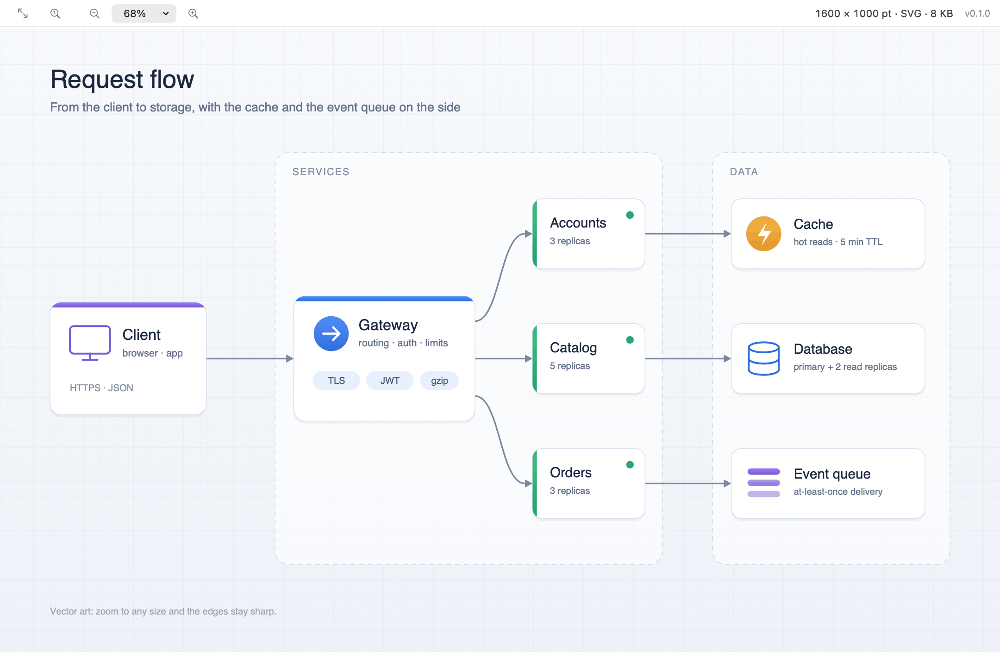

# ImageView — Double Commander WLX plugin (macOS)

Views images in Double Commander's F3 viewer and Quick View with **zoom and pan
that work**: pinch, Cmd+scroll or Cmd+= / Cmd+- to zoom, drag to pan, and SVG
that stays **vector-sharp at any magnification**. It opens 60+ formats through
the system's own decoders, and shows each image's pixel size, format and file
size in its toolbar.



Before this, DC on macOS showed an SVG through the bundled MacPreview (no zoom,
no pan) or its own Graphics mode, which zooms a fixed bitmap and goes soft. See
[#32](https://github.com/NikolaiSachok/DC-plugins/issues/32).

- **Zoom** — pinch; Cmd+scroll or Option+scroll around the pointer; Cmd+= /
  Cmd+- (also `+` / `-` and keypad `+` / `-`); Cmd+0 actual size; Cmd+9 fit; a
  zoom menu with presets from 25% to 1600%; double-click (or two-finger double
  tap) toggles Fit and 100% at the pointer. Up to 6400% (more for a tiny icon),
  down to half of fit.
- **Pan** — drag with the hand cursor, scroll, or the arrows / PgUp / PgDn /
  Home / End / Space.
- **SVG and SVGZ** redrawn as vectors at every zoom level — no external
  fetches, no scripts.
- **Pixel-exact zoom** — past 200% raster pixels are drawn as crisp squares,
  not smeared, so pixel art and screenshots stay legible.
- **Toolbar readout** — `1600 × 1000 · JPEG · 51 KB` (frame count for an
  animation, `pt` for a vector image). The WLX ABI gives a plugin no access to
  DC's status bar, so the plugin's toolbar carries it.
- **Animated GIF, APNG, animated WebP / HEICS** play with the file's own frame
  timing and loop count.
- **Transparency** shown over a checkerboard; EXIF orientation applied; the
  largest entry of an `.ico` / `.icns` shown.
- **Cmd+C** copies the image: a PNG and TIFF for any app, plus the original
  bytes where that is what a paste should get (the SVG source, an animation,
  JPEG / HEIC / WebP, PNG at full size).
- **Light and dark** appearance follow the system.

## Requirements

macOS 11+ and the Xcode command-line tools (`xcode-select --install`) to build.
No other dependencies.

## Build

```sh
./build.sh          # → build/ImageView.wlx  (universal: arm64 + x86_64)
```

The script compiles both architectures, ad-hoc signs the result (`codesign -s -`,
which is all Double Commander needs), and prints the architectures and exported
symbols so you can see the ABI is complete.

## Install

Quit Double Commander first (it rewrites its config on exit), then:

```sh
./install.sh
```

It builds if needed (or uses the prebuilt `ImageView.wlx` in a release bundle),
copies the plugin to `~/Library/Preferences/doublecmd/plugins/wlx/ImageView/`,
backs up `doublecmd.xml`, and registers the plugin **before** MacPreview, whose
`(EXT!="")` would otherwise claim every image. Re-running it is safe. The list
of extensions comes from the plugin itself (`ListGetDetectString`).

### Manual registration (alternative)

*Configuration → Options → Plugins → Plugins WLX → Add*, pick `ImageView.wlx`,
and move it above MacPreview.

## Usage

Press **F3** on an image, or turn on Quick View (**Ctrl+Q**).

| Action | Keys / gesture |
|---|---|
| Zoom in / out | Cmd+= / Cmd+-, `+` / `-`, pinch, Cmd+scroll, Option+scroll |
| Actual size | Cmd+0, toolbar Actual Size button |
| Fit to window | Cmd+9, toolbar Zoom to Fit button |
| Toggle Fit ↔ 100% | double-click, two-finger double tap |
| Pan | drag, scroll, arrows, PgUp / PgDn, Home / End, Space |
| Copy image | Cmd+C |
| Close viewer | Esc |

The zoom an image **opens** at follows DC's own *Image → Stretch* settings
(keys **F** and **L** in the viewer): with *Stretch only large* (the default) a
large image fits the window and a small one opens at 100%; with *Stretch* every
image fits; with neither, everything opens at 100%. Changing the setting
re-fits the open image at once.

Files ImageIO cannot decode (a `.raw` that is a disk image, a broken file) are
left to the next plugin in DC's list, usually MacPreview.

## Supported extensions

PNG, APNG, JPG / JPEG / JPE / JFIF, GIF, WebP, HEIC / HEIF / HIF / HEICS, AVIF,
JXL, TIF / TIFF, BMP / DIB, ICO, CUR, ICNS, PSD, TGA, EXR, HDR, DDS, KTX, ASTC,
PVR, JPEG 2000 (JP2, J2K, JPF, JPX, J2C), PBM / PGM / PPM / PFM, SGI, MPO,
PICT, DICOM (DCM), camera RAW (DNG, CR2, CR3, CRW, NEF, NRW, ARW, SRF, SR2, RAF,
ORF, RW2, RWL, RAW, PEF, SRW, IIQ, 3FR, FFF, MOS, MRW, ERF, DCR), SVG and SVGZ.

What decodes depends on the macOS version: AVIF needs macOS 13, JPEG XL macOS 14.
An unsupported file falls through to the next plugin rather than showing an
error.

## How it works

- **Decoding** is ImageIO, off the main thread. `ListLoad` only reads the
  header, so a file DC hands over that is not an image can be declined
  (`NULL`) and passed to the next plugin. A spinner appears only if decoding
  takes more than a quarter of a second.
- **Very large images** are decoded for display at up to 16384 px on the long
  side and 64 megapixels, through ImageIO's thumbnail path, so a 20000 × 20000
  scan does not cost gigabytes. The toolbar shows the real pixel size, and
  Cmd+C copies the real image.
- **Zoom** is `NSScrollView` magnification, with a clip view that centers an
  image smaller than the window. Raster images are a layer whose contents the
  GPU scales; past 200% they are drawn without interpolation. SVG is drawn by
  CoreSVG's image rep straight into the view on every redraw, so it is
  re-rasterized at the current magnification, and only the part being
  repainted is drawn. (Drawn through `NSImage` instead, CoreSVG renders the
  whole document at the zoomed size first: panning a large diagram at 400%
  took seconds per step, against tens of milliseconds now.)
- **SVG compatibility.** CoreSVG does not know the CSS `transparent` keyword
  and paints it black: `fill="transparent"` (as Miro and other diagram tools
  export connectors) turns into solid wedges, a gradient fading to
  `transparent` into a black band. The keyword is rewritten before CoreSVG
  parses the file — to `rgba(0,0,0,0)` in `fill`, `stroke` and `color`, and
  to black at zero `stop-opacity` / `flood-opacity` in `stop-color` and
  `flood-color`, whose alpha CoreSVG ignores. CSS is rewritten only inside
  `style` attributes and `<style>` elements. Cmd+C still copies the file's
  original source.
- **Cmd+= / Cmd+-** are bound on DC's own Viewer form and never reach the
  plugin's view, so a local event monitor takes them first — only while the
  image has keyboard focus, so Quick View's file panel keeps its keys.

### Escape closes the viewer

The canvas moves focus to DC's view and re-posts Esc through `NSApplication`,
which is where LCL handles its shortcuts. See the charter in
[AGENTS.md](../AGENTS.md).

### Keyboard focus

DC's `SetFocus` is a no-op on macOS, so the plugin takes focus itself when the
viewer window becomes key — but only when no control holds it, so Quick View
leaves focus on the file panel.

### Floating-point traps

Free Pascal enables floating-point exception traps that Apple's frameworks do
not expect. Every ABI entry point runs its work with them masked, and so do
decoding, drawing and zooming.

## Uninstall

Remove the *ImageView* entry under *Options → Plugins → Plugins WLX* and delete
`~/Library/Preferences/doublecmd/plugins/wlx/ImageView/`.

## Test harnesses (development)

All of them drive the real built `.wlx`; they need a GUI session.

```sh
# Generate sample images (no binaries are checked in)
clang -fobjc-arc -framework Cocoa -framework ImageIO -framework UniformTypeIdentifiers \
  -lz -o build/make_samples test/make_samples.m && ./build/make_samples build/samples

# Formats, fall-through, opening zoom, zoom keys, mouse, limits, animation,
# ListLoadNext, SVG sharpness, FP traps
clang -fobjc-arc -framework Cocoa -o build/test_host test/test_host.m
./build/test_host build/ImageView.wlx build/samples

# Esc reaches the host and closes the viewer
clang -fobjc-arc -framework Cocoa -o build/esc_verify test/esc_verify.m
./build/esc_verify build/ImageView.wlx build/samples/photo.jpg

# Keys work straight after F3; Quick View keeps its focus
clang -fobjc-arc -framework Cocoa -o build/focus_verify test/focus_verify.m
./build/focus_verify build/ImageView.wlx build/samples/photo.jpg

# Cmd+C through ListSendCommand (the clipboard is restored afterwards)
clang -fobjc-arc -framework Cocoa -o build/copy_verify test/copy_verify.m
./build/copy_verify build/ImageView.wlx build/samples

# Visual check: render the plugin view to a PNG [zoom%] [width] [height] [dark]
clang -fobjc-arc -framework Cocoa -framework QuartzCore -o build/snap_host test/snap_host.m
./build/snap_host build/ImageView.wlx build/samples/edge.svg build/edge.png 1600
```

These are a regression net, not proof: host key dispatch, focus and gestures
are confirmed in a real Double Commander before a release.
